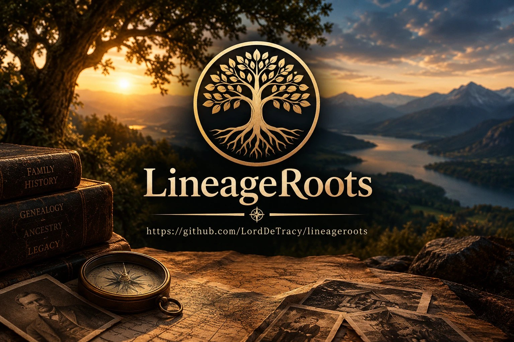
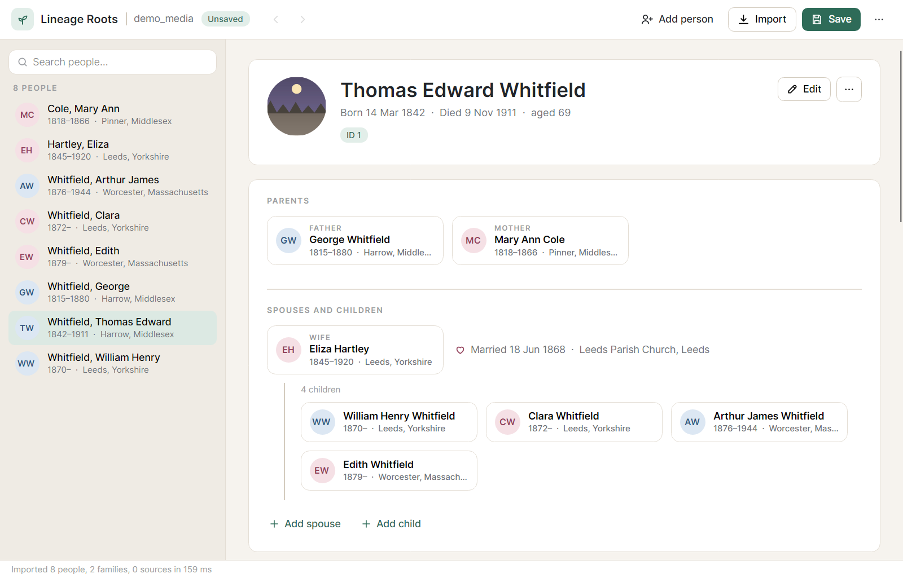
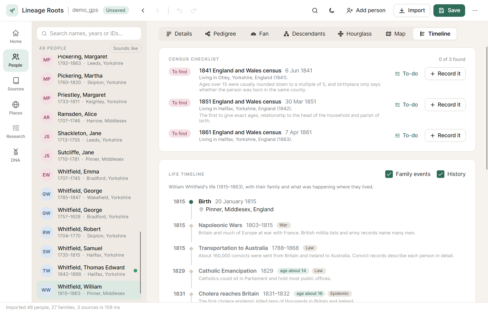
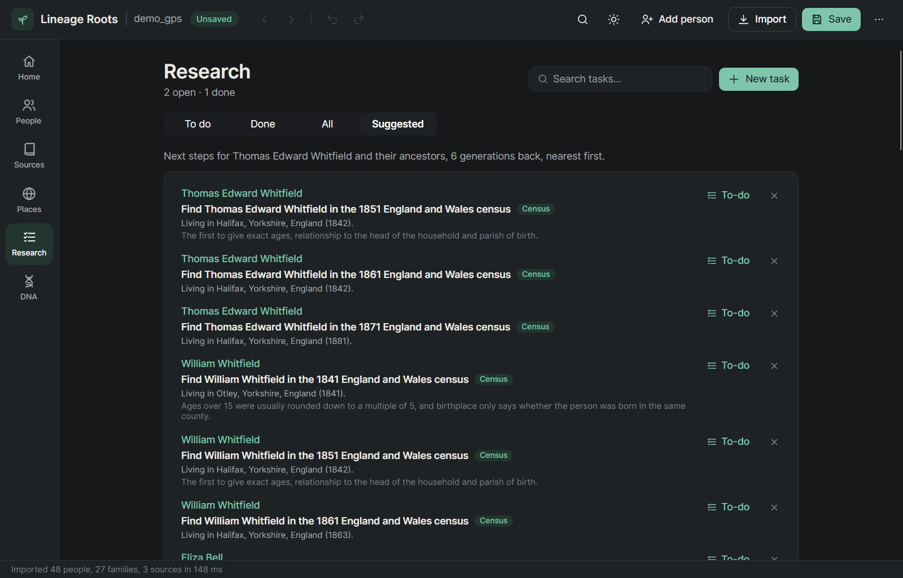
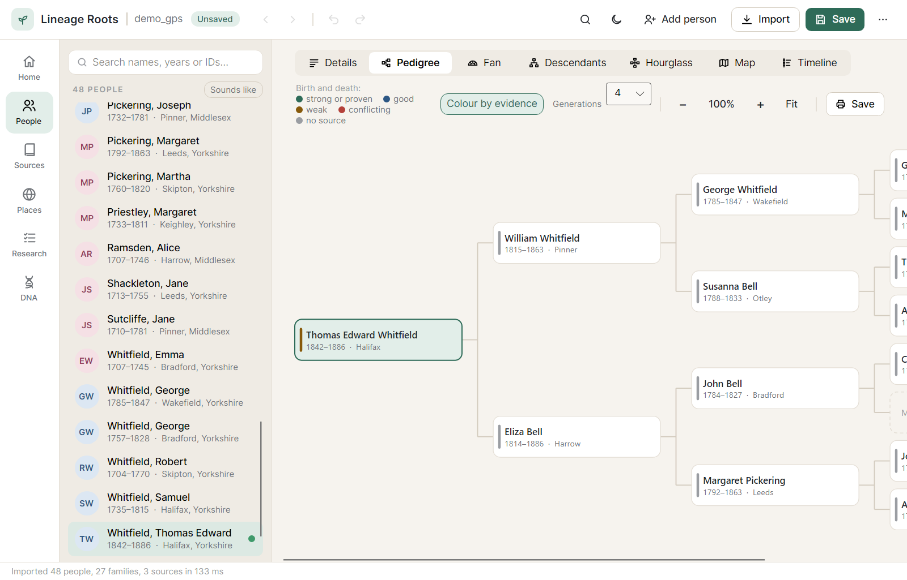
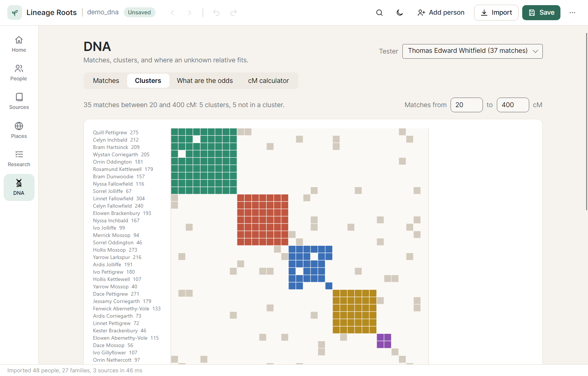
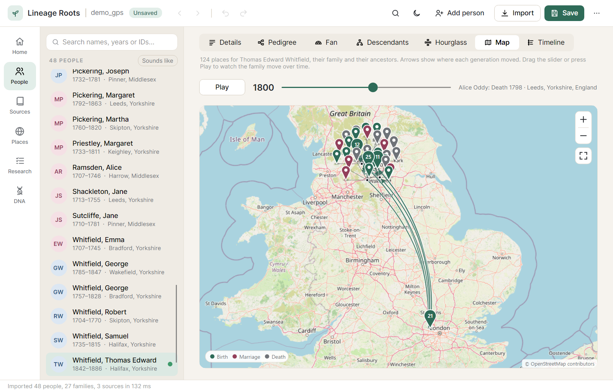
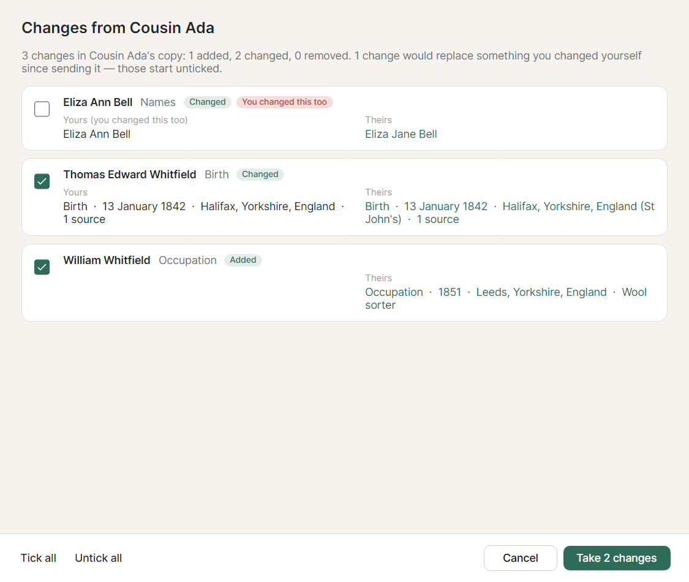

# Lineage Roots

A free, cross-platform family history program, with its source code published for anyone to read and improve. Lineage Roots opens **AQ 16** databases
directly. You don't need AQ installed and you don't need to export from it first. It also reads and writes
**GEDCOM 5.5.1**, so it works with every other genealogy program.

> Status: **0.4.5, early development.** Everything listed below works and is covered by automated tests. The
> FamilySearch features need an app key and have only been tested against simulated responses so far.



## Download

Get the latest version from the [Releases page](https://github.com/LordDeTracy/lineageroots/releases/latest):

| System | File |
|---|---|
| Windows 10/11 (64-bit) | `LineageRoots-<version>-win-x64.zip` — unzip and run `LineageRoots.exe` |
| Windows 7 SP1 / 8.1 (64-bit) | `LineageRoots-<version>-win7-x64.zip` — the same program built for older Windows (see below) |
| Linux (64-bit) | `LineageRoots-<version>-linux-x64.tar.gz` — extract and run `./LineageRoots` |

- The program is a single file: nothing to install, no .NET to download, no folders to keep beside it.
- Keep it somewhere you can write to (Documents or Desktop, not Program Files) so it can update itself.
- Windows may say *"Windows protected your PC"* because the program isn't code-signed yet — choose
  **More info → Run anyway**.
- **It updates itself** from version 0.2.1 on: when a new version is released it asks whether to update, then
  downloads it, checks it and restarts. If you have 0.2 or 0.1.0, download the latest version by hand once.
- **Windows 7 and 8.1:** use the `win7-x64` download. It's built on .NET 6, the last .NET that runs there, which
  no longer gets security fixes from Microsoft. Windows 8 needs the free update to 8.1 first, and Windows 7 needs
  Service Pack 1 and its later updates. Finding faces in photos may not work there; everything else does. It
  updates itself only to newer Windows 7/8.1 builds. It has been tested on Windows 10, not yet on Windows 7 or 8.1.
- The Windows build is the one that is run and tested; the Linux build comes from the same code but hasn't been
  tried on a Linux machine yet.

## Your data stays yours

Everything is kept on your computer. Your AQ or GEDCOM file is never changed — Lineage Roots imports a copy and
saves its own `.lineage` file. The program only goes online for three things, and never sends family details:

- **Street maps**: map pictures from OpenStreetMap for the area you're looking at (can be turned off in Settings)
- **Update check**: asks GitHub whether there's a newer version (can be turned off in Settings)
- **FamilySearch**: only if you set it up and sign in

Finding GPS for places and finding faces in photos both happen inside the program, offline: nothing is sent.

## Why

- **Your data, in an open format.** A `.lineage` file is a plain SQLite database. Saves are transactional
  and atomic, so you never need a "check/repair" step.
- **Fast.** The whole tree lives in memory and every view is a lookup. Importing a 13,000-person AQ database takes
  about 0.4 s.
- **Faithful migration.** AQ record numbers (RIN/MRIN) are kept as Lineage Roots ids, and everything AQ stores comes
  across:
  - names, events, dates (qualifiers, dual dates, ranges and periods), places, notes
  - sources, citations, repositories
  - per-parent child relationships, LDS ordinances with temples and statuses
  - scrapbook links, research items, tags, colours, DNA results, FamilySearch IDs
  - deleted records are recognised and skipped.

## Features

| | |
|---|---|
|  |  |
| Life timeline with history and a census checklist | Suggested next steps for your ancestors |
|  |  |
| Pedigree coloured by how well each person is proven | DNA match clusters |
|  |  |
| The family map, played through the years | Reviewing a relative's changes |

**Your tree**
- Import AQ 16 (`.aq`) and GEDCOM 5.5 / 5.5.1 (`.ged`), including AQ's custom tags; export GEDCOM 5.5.1
- **Home page**: home person, bookmarks, birthdays and anniversaries coming up, open research, "tree health"
  (people with no sources, dates or parents) and the most common surnames
- **People**: instant search by name, year or ID, with an optional "sounds like" mode (Smith finds Smyth)
- **Person editor**: names and alternate names, life dates, relationship to each parent (birth, adopted, step…),
  tags, colour coding, LDS ordinances including sealing to parents, DNA tests, contact details and reference numbers
- **Event editor** for any event type, with date checking, place, GPS, photos and source citations
- **Sources, citations and repositories**, with scans of the original record on each source
- **Research to-do list** linked to people, with priorities and a done filter
- **Research log**: record searches as well as tasks, including the ones that found nothing. "Searched…" on a
  suggestion asks where you looked and what came of it; the suggestion isn't offered again, the census checklist
  says when and where you searched, and the Research page has a search log, newest first
- **Suggested next steps** on every person's page, and for the home person's ancestors on the Research page: missing
  parents, births, marriages and deaths, censuses they should be in, emigration, military service (draft cards,
  Civil War, First World War), wills and probate, gaps between children, and facts without sources. Each says why
  it was suggested and where such records usually are for that country and period; one click makes it a task
- **Quick search** (Ctrl+K): type to jump to any person, place or source, or to run a command
- **Filters** on the people list: a place (any of their events or marriages), born or died between two years, alive
  at some time in a span of years, and men or women, on top of the name search
- The search box also finds words in notes and event descriptions: search "killed in the mine" and anyone whose
  story says so is listed, marked "Found in notes", after the people whose names match
- Person cards (parents, spouses, children) show the person's title and latest occupation, to tell relatives apart
- **Christening and burial instead of birth and death** in the person editor, for when that's all there is (a
  foundling, say); they count as birth and death for dates, ages and filters
- **Plural marriages**: mark a marriage as one of several at the same time (polygamy), shown on the spouse's card
- **Saves by itself**: every change is saved a moment later (Undo still works), an imported tree is saved straight
  away as a copy in Documents\Lineage Roots, the last tree opens again at start, and importing the same AQ or GEDCOM
  file again offers the copy with your changes. It can be turned off in Settings
- **Tree health lists**: on Home, "23 people have no birth date" lists all 23 so you can work through them, and Back
  returns to where you were
- **Picks up where you left off**: the program reopens your tree at the person, section and view you were on
- **Relationship indicators**: each person's page and family cards say how they're related to the home person
  ("Kay's 3rd great-grandfather", "Kay's wife's aunt")
- **Old Style dates** (before 1752, when the year began on 25 March): "10 Feb 1600" and "1600/01" don't raise false
  problems, and dual dates sort by the year as counted now
- **Undo and redo** for every edit (Ctrl+Z / Ctrl+Y)

**Charts and maps**
- Pedigree, fan, descendant and hourglass charts. Click to centre, double-click to open, mouse wheel to zoom,
  drag to pan. Save as a picture, or print as a wall chart (one big poster, or pages to tape together)
- A map of where a family lived, with arrows from each parent's birthplace to the child's, and a map of every
  place in the tree (street maps from OpenStreetMap, or a plain grid when that is turned off). Drag the year slider
  or press Play to watch the family spread over the generations
- A life timeline for each person: their own events with their age at each one, births, marriages and deaths in
  their family, and history where they lived — wars, epidemics, emigration waves, and changes in the law and in
  record keeping (about 80 events for the United States, Britain, Ireland, Canada, Australia, New Zealand and
  parts of Europe)
- A census checklist: every census taken while the person was alive, in the country where they were living, marked
  found, to find, maybe (they moved, or may have died) or lost (the 1890 US census, most Irish censuses before
  1901). One click adds a research task or records the census. Covers the United States, England, Wales,
  Scotland, Ireland, Canada, Norway and Sweden
- **Census household entry**: pick a census and the form has that year's real columns (relationship to head,
  marital status, age, occupation, birthplace, years married, year of immigration…). The household is filled in
  from the tree with ages as of census day; correct it from the page, link each line to a person or add newcomers
  as new people (a wife, son or daughter is linked to the head), and save — everyone gets a census event citing it,
  occupations can be added as facts, and the checklist ticks itself off

**Places and photos**
- Places page: GPS for a whole place at once, rename or merge, and suggested clean-ups ("Leeds, Yorks" →
  "Leeds, Yorkshire, England")
- **Find GPS for places**: looks up every place without coordinates in a built-in gazetteer of the world's towns
  (offline), using the country, state or county in the name to pick the right one. Sure matches are ticked for you;
  likely ones and state-only matches are left for you to check. Applied in one undoable step
- Photos on people, events, marriages and sources; a profile picture; tag people in group photos; GPS and date
  read from the camera; copy every photo into a folder beside the tree so they travel together; find moved photos
- **Faces found for you**: open a photo and the faces in it are outlined (found on your computer, offline, even the
  small faces of a big group photo); click one and say who it is to tag them

**Checking your work**
- **Evidence for every fact**: rate each citation the way the Genealogical Proof Standard does — original record,
  copy or compiled work; first-hand or second-hand information; direct, indirect or negative evidence. Each fact
  is shown as strong, good, weak, conflicting or without a source (independent sources corroborate one another),
  with tips on what would make it stronger. Record conflicting records and how you settled them, mark a fact
  proven or disproved with your reasoning, and colour the charts by how well each person's birth and death are
  proven. Two records of the same birth, death or marriage that disagree are flagged automatically, and merging
  two people turns their differences into conflicts to settle. Ratings are kept in GEDCOM (and written as the
  standard quality rating too)
- Find and merge duplicates (merges keep everything and can be undone)
- Problem finder: impossible or unlikely dates and relationships
- Relationship calculator ("2nd cousin once removed", "wife's aunt") with the line of people between them
- Compare with another tree (a cousin's GEDCOM): who matches, what differs, and copy people across
- **Share with relatives and merge their changes back**: save a copy for a cousin (living people left out if you
  like); when they send their edited copy back — as a Lineage Roots file or a GEDCOM — review what they changed one
  change at a time: new people and families, corrected names, added or changed facts and sources, removals. Your
  tree keeps a record of what was sent, so their edits are told apart from yours, and anything you both changed is
  flagged and starts unticked. Take what you want in one undoable step; what you turn down isn't offered again
  unless they change it again

**DNA**
- DNA matches for anyone who tested: shared cM, segments, company, notes and shared matches, typed in or imported
  from a CSV match list or shared-matches list (column names are recognised automatically; downloading again
  updates rather than duplicates). Match lists name living people, so privacy-filtered exports leave them out
- Link identified matches to people in the tree, and each one is checked against the tree: "tree says 1st cousin —
  fits", or a warning when that much DNA is unlikely for the relationship the tree gives
- Shared cM calculator: the likely relationships for an amount of shared DNA, with odds and typical ranges. The
  numbers come from simulating inheritance (48 relationships × 20,000 simulated pairs, with realistic crossover
  patterns), so no outside data is needed
- What Are The Odds: test where someone fits — "child of this couple" or "child of that person" — against the DNA
  they share with every tested relative in the tree, and rank the places. Only birth links count
- Match clusters: groups matches who share matches with each other (like the Leeds method and autoclusters), shown as
  a coloured grid, with the ancestors the linked matches in each cluster point to
- **Chromosome painter**: import segment downloads (FamilyTreeDNA chromosome browser, MyHeritage shared segments,
  GEDmatch one-to-one) and each segment shared with a linked match is painted on the chromosomes with the ancestors
  you have in common, on your father's or mother's side, with how much of each side is painted so far

**Reports and sharing**
- PDF or Word: family group sheet, individual summary, ancestors, descendants (outline or narrative "register"
  style), lists of places and surnames, a birthday calendar, and a whole family history book with contents,
  sources and an index
- A family website (plain HTML that works offline from a USB stick or any web host)
- Privacy: GEDCOM and website exports can hide or leave out living people, private events, notes and photos

**Safety**
- Each save keeps the previous version in a backups folder; while there are unsaved changes a recovery copy is
  written every few minutes and offered back after a crash; closing asks before discarding changes
- Several trees open at once, each in its own window
- **Updates itself**: at start-up it asks GitHub whether there's a newer release (nothing about your family is
  sent) and, if you agree, downloads it, checks it against GitHub's SHA-256 checksum, and restarts into the new
  version. Unsaved changes are offered for saving first. Turn the check off in Settings, or check any time from the
  ⋯ menu. Publishing a GitHub release with the Windows zip and Linux tarball attached is all an update needs
- **FamilySearch**: open a linked person on FamilySearch.org, find and link people, compare and copy details, and
  download ancestors. Read-only; needs your own app key from the
  [FamilySearch developer program](https://www.familysearch.org/developers/)
- Light and dark themes (the sun/moon button at the top); every control has a screen-reader name

## Building

You need the [.NET 8 SDK](https://dotnet.microsoft.com/download).

```bash
dotnet build
dotnet run --project src/Lineage.App
dotnet test
```

To open a file at startup, pass its path: `dotnet run --project src/Lineage.App -- family.aq`

### Making a release

The app updates itself from this repository's GitHub releases, so a release needs files named the same way each
time. Set `<Version>` in `src/Lineage.App/Lineage.App.csproj`, then build the single-file programs:

```bash
dotnet publish src/Lineage.App -c Release -r win-x64 --self-contained true -p:PublishSingleFile=true -p:IncludeNativeLibrariesForSelfExtract=true -p:DebugType=none -o publish/win-x64
```

For Windows 7 SP1 and 8.1, build the same program on .NET 6 with `-p:Legacy=true` and package it as
`LineageRoots-<version>-win7-x64.zip`:

```bash
dotnet publish src/Lineage.App -p:Legacy=true -c Release -r win-x64 --self-contained true -p:PublishSingleFile=true -p:IncludeNativeLibrariesForSelfExtract=true -p:DebugType=none -o publish/win7-x64
```

```bash
dotnet publish src/Lineage.App -c Release -r linux-x64 --self-contained true -p:PublishSingleFile=true -p:IncludeNativeLibrariesForSelfExtract=true -p:DebugType=none -o publish/linux-x64
```

Package them as `LineageRoots-<version>-win-x64.zip` and `LineageRoots-<version>-linux-x64.tar.gz` (keeping the
Linux program executable), with `LICENSE`, a `README.txt` and the Lato font's licence (`OFL.txt` from the QuestPDF
package) beside the program. Publish a GitHub release tagged `v<version>` with both attached; the app finds it,
checks the download against the SHA-256 GitHub records for each uploaded file, and offers it. Drafts and
pre-releases aren't offered.

## Layout

| Project | Contents |
|---|---|
| `src/Lineage.Core` | the model (`FamilyTree`, `Person`, `Family`, `Event`, `GenDate`…), SQLite storage, AQ and GEDCOM import, GEDCOM export, and the analysis behind the features: duplicates, problems, places, relationships and evidence (`Analysis`), timelines, censuses, history and research suggestions (`History`), DNA inheritance model, odds, clustering and chromosome painting (`Dna`), sharing with relatives (`Sharing`), reports and the family website |
| `src/Lineage.App` | the Avalonia desktop app (MVVM, CommunityToolkit.Mvvm): pages, editors, charts, maps, PDF and Word reports, and the updater |
| `tests/Lineage.Core.Tests` | xUnit tests for the format, storage, GEDCOM, undo, merging, analysis, history, DNA and sharing |
| `tests/Lineage.App.Tests` | headless UI tests that drive the app's workflows (Avalonia.Headless) |

The DNA model's table (`src/Lineage.Core/Dna/CmModelData.cs`) is generated by simulation; to regenerate it, run
`dotnet test tests/Lineage.Core.Tests --filter RegenerateCmModel` with `LINEAGE_GENERATE_CM=20000` set.

### Tests and private sample data

Some tests check the AQ importer against AQ's **own** GEDCOM export of the same database. They
compare every person, name, sex, date, place, family and child. Those samples are real family data, so they are
never committed. Put pairs such as `family.aq` and `family_aqexport.ged` in a `samples/real/` folder above the
repository, or point `LINEAGE_SAMPLES` at the folder. Without samples, these tests pass as no-ops and every other
test still runs.

## AQ compatibility

The `.aq` reader was written from documentation of the file format. That documentation came from analysing the
program for interoperability and was checked against AQ's own exports of real databases. No AQ code
is used or included. The importer is read-only and never modifies an `.aq` file.

Lineage Roots is an independent project. It is not affiliated with, endorsed by or connected to the makers of AQ,
and "AQ" is used here only to say which files it can read.

Supported: AQ 16 (`.aq`, format "3600"). Older AQ formats and PAF files can be imported by exporting them to
GEDCOM first.

## Roadmap

- Record hints and FamilySearch upload (deliberately not started yet)
- Per-change history saved inside the file (undo currently lasts for the session)
- GEDCOM media records referenced by pointer (`0 @M1@ OBJE`)
- Password-protected tree files
- Code-signed Windows builds, and a macOS build

## License

[PolyForm Noncommercial 1.0.0](LICENSE). You may use, copy, change and share Lineage Roots for any
noncommercial purpose: personal and family history research, hobbies, study, teaching, and use by
charities, schools, libraries, archives and government bodies. Commercial use — selling it, building it
into a paid product or service, or using it to run a business — is not allowed.

Because commercial use is excluded, this is a "source-available" licence rather than an open-source one in
the strict sense of the Open Source Definition.

Lineage Roots uses these libraries, each under its own licence: Avalonia, CommunityToolkit.Mvvm,
Microsoft.Data.Sqlite, DocumentFormat.OpenXml and ONNX Runtime (MIT), MetadataExtractor (Apache 2.0) and QuestPDF
(QuestPDF Community License). The Lato font built into the program for reports is used under the SIL Open Font
License 1.1. Street maps are © OpenStreetMap contributors. Place coordinates come from
[GeoNames](https://www.geonames.org/) (CC BY 4.0). Faces are found with the
[Ultra-Light-Fast-Generic-Face-Detector-1MB](https://github.com/Linzaer/Ultra-Light-Fast-Generic-Face-Detector-1MB)
model (MIT, © 2019 linzai). The Lineage Roots logo, icon and artwork are in [docs/brand](docs/brand).
